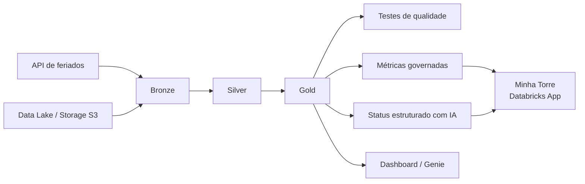

# Vértice — Control Tower de projetos

Projeto de engenharia de dados e analytics com Databricks para acompanhamento de
projetos, tarefas, custos, fornecedores, pessoas e indicadores de risco.

O repositório contém duas partes principais:

- **Lakehouse e pipelines:** notebooks, SQL, jobs, pipelines e dashboards
  definidos como Databricks Asset Bundles.
- **Aplicação Minha Torre:** frontend React/TypeScript e backend Express
  executados como Databricks App.

## Arquitetura



## Demonstração

O dashboard é servido pela aplicação **Minha Torre** no Databricks Apps. Para
adicionar capturas de tela ao portfólio, salve imagens sanitizadas em
`docs/images/` e referencie-as no README. Não inclua dados reais de clientes,
IDs de workspace, URLs privadas ou informações pessoais nas imagens.

## Estrutura do repositório

| Caminho | Descrição |
| --- | --- |
| `src/` | Notebooks e consultas SQL das camadas de dados |
| `resources/` | Jobs, pipelines, dashboards e recursos do bundle |
| `minha-torre/` | Aplicação web React + Express |
| `scripts/` | Scripts auxiliares de validação e execução |
| `tests/` | Testes Python do projeto |
| `databricks.yml` | Configuração dos Databricks Asset Bundles |
| `pyproject.toml` | Dependências e configuração Python |

## Pré-requisitos

- Git
- Python 3.10 ou superior
- [uv](https://docs.astral.sh/uv/getting-started/installation/)
- [Databricks CLI](https://docs.databricks.com/dev-tools/cli/install.html)
- Node.js 22 ou superior e npm
- Acesso ao workspace Databricks, ao SQL Warehouse e aos recursos usados pelo
  projeto

## Segurança e credenciais

**Nunca faça commit de tokens, senhas, chaves de storage ou arquivos `.env`.**

As credenciais locais devem ser configuradas fora do Git:

```powershell
Copy-Item minha-torre\.env.example minha-torre\.env
```

Depois, preencha `minha-torre\.env` com os valores do seu ambiente:

```env
DATABRICKS_HOST=https://seu-workspace.cloud.databricks.com
DATABRICKS_WAREHOUSE_ID=seu_sql_warehouse_id
DATABRICKS_GENIE_SPACE_ID=seu_genie_space_id
DATABRICKS_APP_PORT=8000
DATABRICKS_APP_NAME=minha-torre
```

As variáveis `s3_access_key_id` e `s3_secret_access_key` do bundle devem ser
fornecidas durante o deploy, por perfil seguro do Databricks CLI ou pelo
gerenciador de segredos da sua organização. Elas não devem ser gravadas em
`databricks.yml`, em arquivos de override ou no histórico do Git.

Se uma chave real tiver sido exposta, mesmo que apenas localmente, revogue-a e
gere outra antes de publicar ou compartilhar o projeto.

## Configuração local

### Python e Databricks Bundle

Na raiz do projeto:

```powershell
uv sync --dev
databricks auth login --host https://seu-workspace.cloud.databricks.com
```

Valide o bundle antes do deploy. Os valores específicos do ambiente são
fornecidos por linha de comando e não são armazenados no repositório:

```powershell
databricks bundle validate -t dev `
  --var="warehouse_id=seu_sql_warehouse_id" `
  --var="deployment_user_email=seu-usuario@empresa.com"
```

### Aplicação Minha Torre

```powershell
cd minha-torre
npm install
npm run dev
```

Para gerar os artefatos de produção:

```powershell
npm run build
```

## Testes e validações

Na raiz:

```powershell
uv run pytest
databricks bundle validate -t dev
```

Na aplicação:

```powershell
cd minha-torre
npm run typecheck
npm run lint
npm run test
npm run build
```

## Deploy no Databricks

### Dados, jobs e dashboards

Na raiz do projeto:

```powershell
databricks bundle deploy -t dev `
  --var="warehouse_id=seu_sql_warehouse_id" `
  --var="deployment_user_email=seu-usuario@empresa.com"
```

Para produção:

```powershell
databricks bundle deploy -t prod `
  --var="warehouse_id=seu_sql_warehouse_id" `
  --var="deployment_user_email=seu-usuario@empresa.com"
```

O usuário informado em `deployment_user_email` deve existir no workspace e ter
as permissões necessárias. Em produção, ele recebe `CAN_MANAGE` sobre o bundle;
revise essa permissão conforme a política de acesso da organização.

### Minha Torre

Na pasta da aplicação:

```powershell
cd minha-torre
npm run build
databricks apps deploy
```

Ao usar o bundle da aplicação diretamente, forneça os identificadores do
ambiente sem gravá-los no arquivo:

```powershell
databricks bundle deploy -t default `
  --var="sql_warehouse_id=seu_sql_warehouse_id" `
  --var="genie_space_id=seu_genie_space_id" `
  --var="genie_space_name=seu_nome_de_genie_space"
```

O comando de deploy valida a aplicação, publica a versão e informa a URL
disponível. Para iniciar uma aplicação já publicada sem novo deploy:

```powershell
databricks apps start minha-torre
```

Os IDs dos recursos `sql-warehouse` e `genie-space` são configurados pelo
`app.yaml` no ambiente Databricks; não coloque tokens no código-fonte.

## Publicação no GitHub

O GitHub armazena o código-fonte e o histórico. A execução ocorre no Databricks.

```powershell
git init -b main
git remote add origin https://github.com/gustavosantosl/ProjetoControlTower.git
git add .
git status
git commit -m "Publica projeto Vertice"
git push -u origin main
```

Antes do primeiro `git push`, confirme que arquivos sensíveis não estão no
staging:

```powershell
git status --short
git diff --cached --name-only
git diff --cached -- .env
```

O arquivo `.gitignore` exclui configurações locais, credenciais, dependências,
builds e artefatos gerados. Ainda assim, revise o staging manualmente antes de
publicar.

## Licença

Este projeto ainda não define uma licença de distribuição. Consulte os
responsáveis antes de reutilizar ou redistribuir o código.
